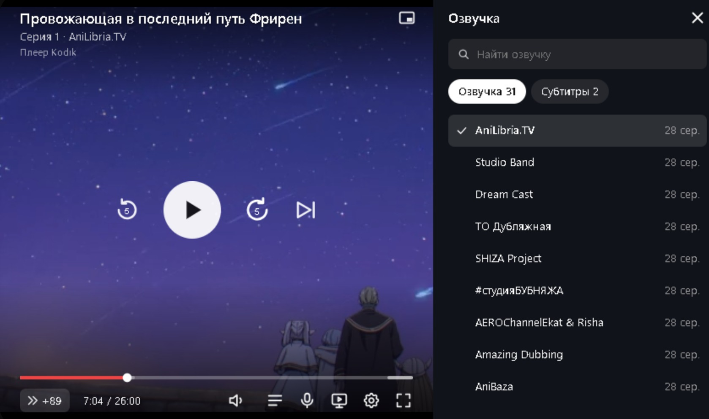
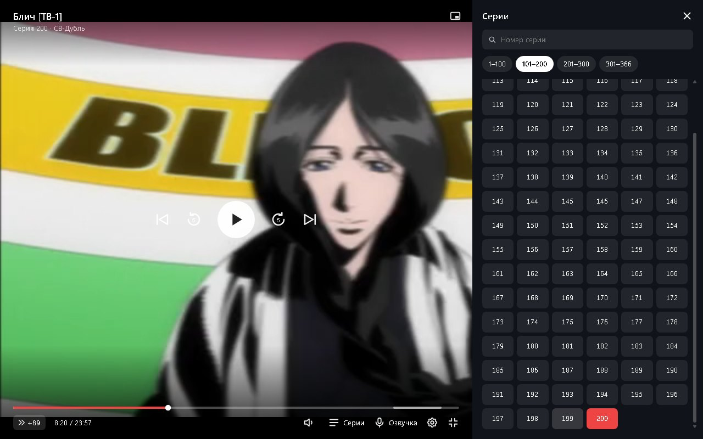
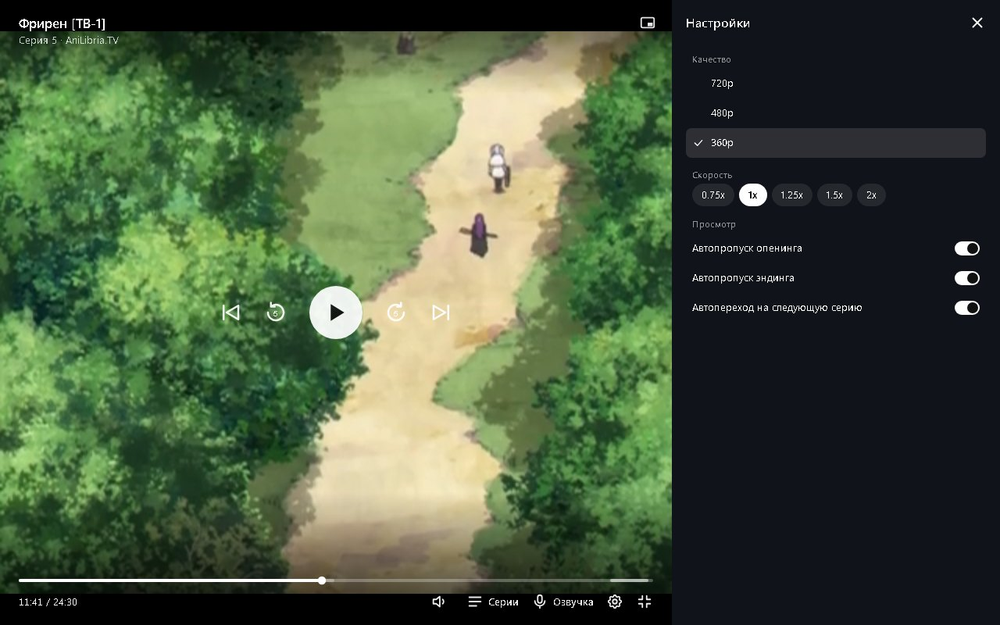
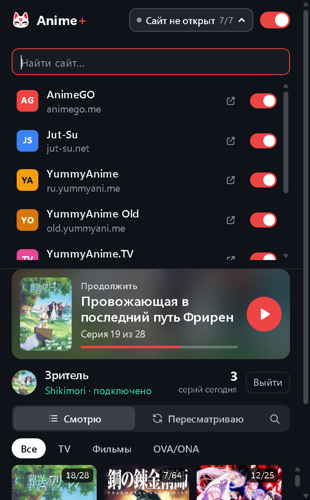
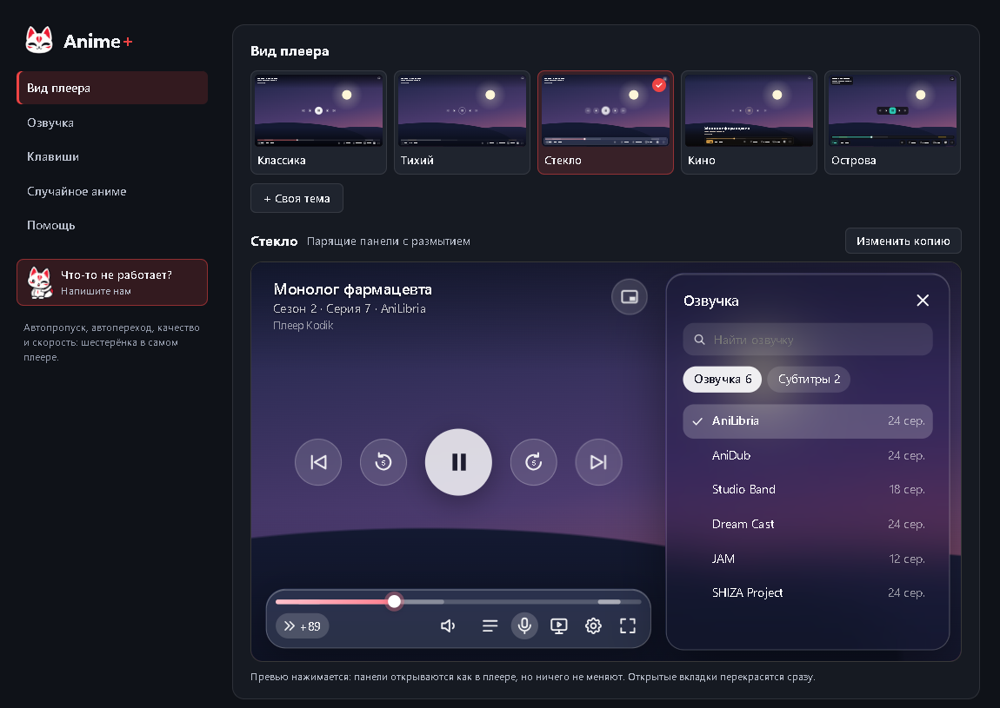
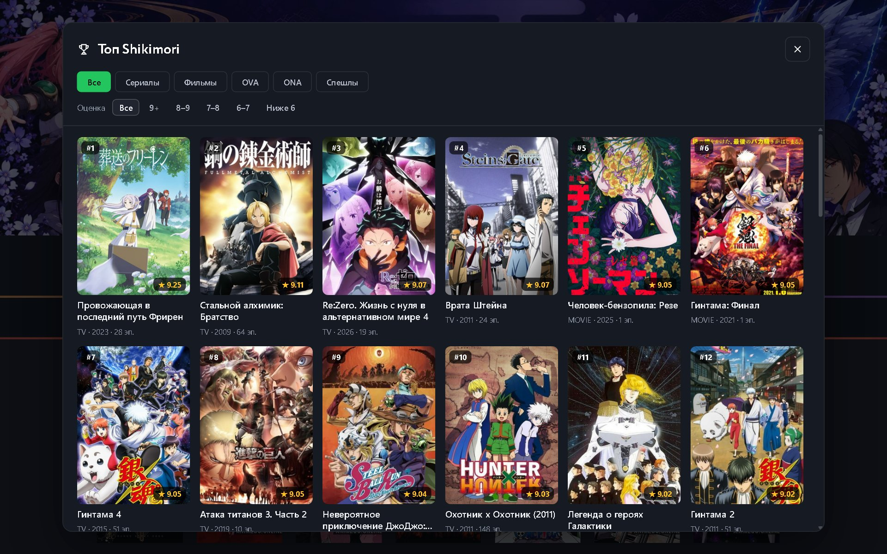
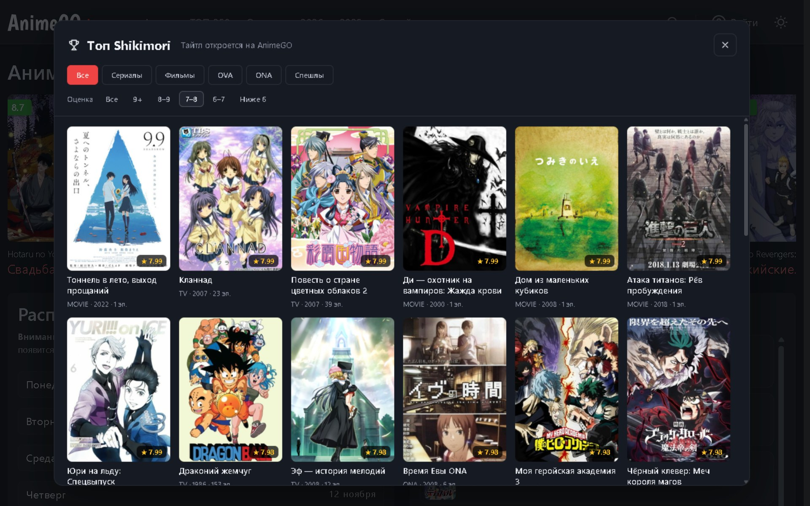
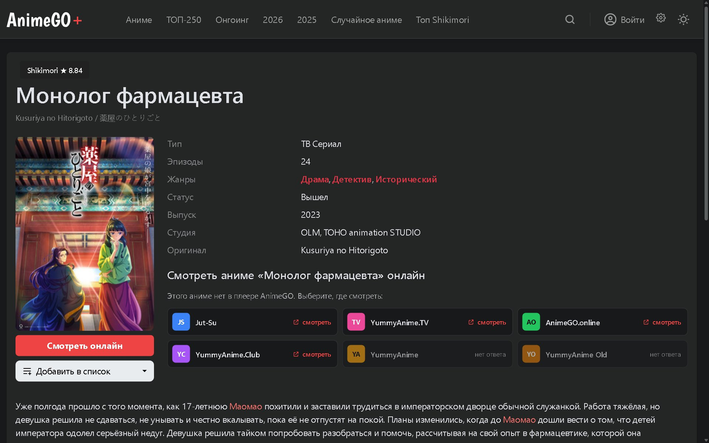

<p align="center">
  
</p>

<h1 align="center">Anime+</h1>

<p align="center">
  <b>Смотри аниме без лишних нажатий: пропуск опенингов, марафон серий и учёт в Shikimori.</b>
</p>

<p align="center">
  <a href="https://chromewebstore.google.com/detail/anime+/mgcaideibpbdddnbedoefmabladoaajg?hl=ru" target="_blank">
    
  </a>
  <a href="https://chromewebstore.google.com/detail/anime+/mgcaideibpbdddnbedoefmabladoaajg?hl=ru" target="_blank">
    
  </a>
  <a href="https://chromewebstore.google.com/detail/anime+/mgcaideibpbdddnbedoefmabladoaajg?hl=ru" target="_blank">
    
  </a>
</p>

<p align="center">
  
</p>

<p align="center">
  <a href="#-возможности">Возможности</a> •
  <a href="#-поддерживаемые-сайты">Сайты</a> •
  <a href="#-скриншоты">Скриншоты</a> •
  <a href="#-установка">Установка</a> •
  <a href="#️-управление">Управление</a> •
  <a href="#-приватность">Приватность</a> •
  <a href="#-поддержка">Поддержка</a>
</p>

---

## ⚡ Коротко

**Anime+** работает на AnimeGO, Jut-Su, YummyAnime и других сайтах и убирает всё, что отвлекает от просмотра:

- ⏭️ **Опенинги и эндинги пропускаются сами,** а сэкономленное время видно в окне расширения.
- 🍿 **Следующая серия включается сразу,** без ожидания и лишних нажатий.
- 🎬 **Серии и озвучка переключаются прямо в плеере,** даже в полном экране.
- 🎙️ **Ваша озвучка выбирается сама,** а ручной выбор запоминается для тайтла.
- 📊 **Просмотренные серии отмечаются в Shikimori** без вашего участия.

---

## ✨ Возможности

### 🎬 Улучшенный плеер Kodik
- Управление появляется при движении мыши и не мешает смотреть.
- Серии, озвучка и выбор плеера открываются в панелях поверх видео.
- Длинные сериалы разбиты на группы, есть поиск по номеру серии.
- На шкале отмечены опенинг и эндинг, при наведении видны кадры серии, если они есть у плеера.
- Настоящий полный экран, который не сбрасывается при смене серии.
- Кнопка **+89 секунд** для ручного пропуска и режим «картинка в картинке».

### ⏭️ Пропуск опенингов и эндингов
- Источники времени: метки плеера и сайта, общая база таймингов, узнавание песни по звуку и AniSkip.
- Песни узнаются для почти 1000 тайтлов, база постоянно пополняется.
- Автопропуск опенинга и эндинга настраивается отдельно.
- Кнопка **«Вернуться»** исправляет ошибочный пропуск одним нажатием.
- Если вы сами вернулись к песне, плеер больше не перекинет вас вперёд.

### 🍿 Марафон серий
- Серия закончилась, и сразу запускается следующая.
- Если вы развернули плеер, полный экран сохраняется.

### 🎙️ Озвучка
- Автовыбор по вашему списку приоритетов.
- Озвучка, выбранная вручную, важнее автовыбора и запоминается для тайтла.

### 📊 Shikimori
- Расширение определяет аниме и серию и само обновляет прогресс в профиле.
- Серия засчитывается после просмотра 80%, её можно досматривать частями. Перемотка в конец и реклама не считаются.
- После перезагрузки страницы или смены озвучки серия продолжается с места остановки.
- Пересмотр старой серии не уменьшает прогресс.
- Для уже просмотренного тайтла статус меняется на **«Пересматриваю»**.
- Оценки Shikimori видны прямо на страницах тайтлов.

### 📱 Окно расширения
- Карточка **«Продолжить»** запускает последний тайтл одним нажатием.
- Ваши списки в виде обложек с прогрессом, поиском и фильтрами по типам.
- Уведомления о новых сериях и список вышедших за сутки.
- Опенинги и эндинги текущего аниме со ссылками на YouTube.

### 🔎 Поиск нового аниме
- **Топ Shikimori:** весь рейтинг в одном окне, с подгрузкой при прокрутке и быстрым переходом по оценкам.
- **Случайное аниме** по вашим фильтрам: оценка и тип.
- **Кнопка `▶ Смотреть с Anime+`** на Shikimori ищет тайтл на включённых сайтах.
- **Кнопка `Смотреть на…`** открывает этот же тайтл на другом сайте.

### ✨ Дополнительно на AnimeGO
- Если тайтла нет на сайте, расширение покажет его карточку и предложит, где посмотреть.
- Расширенное расписание дополняется тайтлами с Jut-Su и настраивается фильтрами.

### ⚙️ Настройки
- Всё для просмотра находится прямо в меню плеера и применяется сразу.
- Озвучки, случайное аниме и клавиши настраиваются на отдельной странице расширения.

---

## 🌍 Поддерживаемые сайты

| Сайт | Адрес |
| :--- | :--- |
| AnimeGO | [animego.me](https://animego.me), animego.org |
| Jut-Su | [jut-su.net](https://jut-su.net) |
| YummyAnime | [ru.yummyani.me](https://ru.yummyani.me), [old.yummyani.me](https://old.yummyani.me) |
| YummyAnime.TV | [yummyanime.tv](https://yummyanime.tv) |
| AnimeGO.online | [animego.online](https://animego.online) |
| YummyAnime.Club | [yammyanime.club](https://yammyanime.club) |

Каждый сайт можно отдельно включить или выключить в окне расширения.

<details>
<summary><b>Что работает на каких сайтах</b></summary>
<br>

| Функция | AnimeGO | Jut-Su | YummyAnime (ru, old) | YummyAnime.TV, AnimeGO.online, YummyAnime.Club |
| :--- | :---: | :---: | :---: | :---: |
| Улучшенный плеер и полный экран | ✅ | ✅ | ✅ | ✅ |
| Пропуск опенингов и эндингов | ✅ | ✅ | ✅ | ✅ |
| Отметка серий в Shikimori | ✅ | ✅ | ✅ | ✅ |
| Автовыбор озвучки | ✅ | ✅ | — | ✅ |
| Топ Shikimori | ✅ | ✅ | ✅ | ✅ |
| Случайное аниме по вашим фильтрам | ✅ | ✅ | ✅ | ✅ |
| «Смотреть на…» другие сайты | — | — | ✅ | ✅ |
| Расширенное расписание | ✅ | — | — | — |
| Карточки тайтлов, которых нет на сайте | ✅ | — | — | — |

Улучшенный плеер работает в плеере Kodik. На YummyAnime озвучку выбирает сам сайт. На YummyAnime.TV, AnimeGO.online и YummyAnime.Club расширение само включает Kodik.

</details>

---

## 📸 Скриншоты

<details>
<summary><b>🎬 Плеер</b></summary>
<br>

| Шкала с кадрами серии | Серии длинного сериала |
| :---: | :---: |
|  |  |

| Настройки в плеере | Основной вид |
| :---: | :---: |
|  |  |

</details>

<details>
<summary><b>📱 Окно расширения и настройки</b></summary>
<br>

| Списки Shikimori | Сайты | Страница настроек |
| :---: | :---: | :---: |
|  |  |  |

</details>

<details>
<summary><b>🏆 Топ Shikimori</b></summary>
<br>

| Весь рейтинг | Переход по оценкам |
| :---: | :---: |
|  |  |

</details>

<details>
<summary><b>🧭 Где посмотреть</b></summary>
<br>

| Кнопка на Shikimori | Тайтла нет на AnimeGO |
| :---: | :---: |
|  |  |

</details>

<details>
<summary><b>🗓️ Расписание на AnimeGO</b></summary>
<br>

| Расписание | Его настройки |
| :---: | :---: |
|  |  |

</details>

---

## 🚀 Установка

**Из Chrome Web Store (рекомендуется):** откройте [страницу расширения](https://chromewebstore.google.com/detail/anime+/mgcaideibpbdddnbedoefmabladoaajg?hl=ru) и нажмите **«Установить»**.

<details>
<summary><b>Из исходного кода</b></summary>
<br>

1. Нажмите **`Code` ➔ `Download ZIP`** вверху страницы и распакуйте архив.
2. Откройте в браузере `chrome://extensions/`.
3. Включите **«Режим разработчика»** в правом верхнем углу.
4. Нажмите **«Загрузить распакованное расширение»** и укажите папку с проектом.

</details>

---

## ⌨️ Управление

| Клавиша | Действие |
| :---: | :--- |
| <kbd>F</kbd> | На весь экран и обратно |
| <kbd>Esc</kbd> | Закрыть панель или выйти из полного экрана |
| <kbd>Пробел</kbd> | Пауза и продолжение |
| <kbd>S</kbd> | Пропустить опенинг или эндинг, вне песни перемотать на 89 секунд |
| <kbd>←</kbd> / <kbd>→</kbd> | Перемотка на 5 секунд назад и вперёд |
| <kbd>N</kbd> / <kbd>P</kbd> | Следующая и предыдущая серия |

Колесо мыши над регулятором громкости меняет громкость на 1%.

Клавиши <kbd>F</kbd>, <kbd>S</kbd>, <kbd>←</kbd>, <kbd>→</kbd>, <kbd>N</kbd> и <kbd>P</kbd> можно заменить на странице настроек расширения.

---

## 🔒 Приватность

- Настройки и данные хранятся локально в вашем браузере.
- Расширение не собирает данные для рекламы и аналитики.
- Звук серии анализируется только на вашем устройстве, не сохраняется и никуда не отправляется.
- Если время опенинга или эндинга найдено по звуку, на сервер разработчика отправляются только ID тайтла, номер серии, название озвучки, длина видео и найденное время. Так другие зрители получают пропуск сразу. IP-адрес не хранится. Функция отключается в меню плеера: «Пропуск по звуку».
- Если вы подключаете Shikimori, запросы идут от вашего имени, а код авторизации и токены проходят через прокси-сервер разработчика.
- Для поиска тайтла поддерживаемым сайтам передаётся его название.

Подробнее: [политика конфиденциальности](PRIVACY_POLICY.md).

---

## 💬 Поддержка

Нашли ошибку или есть идея? Напишите на [animeplussupport@gmail.com](mailto:animeplussupport@gmail.com). Если что-то сломалось, укажите сайт, тайтл и номер серии.

---

## 🛠️ Разработка

Сборка не нужна: папку проекта можно сразу загрузить как распакованное расширение. Для проверок нужен [Node.js](https://nodejs.org):

```bash
npm install
npm run check
```

`npm run check` запускает линтер и тесты. Устройство проекта описано в [AI_OVERVIEW.md](AI_OVERVIEW.md).

---

<p align="center">
  <a href="https://github.com/lredi1337"></a><br>
  Создано разработчиком <a href="https://github.com/lredi1337">l_red_i</a> для аниме-сообщества. Лицензия <a href="LICENSE">MIT</a>.
</p>
