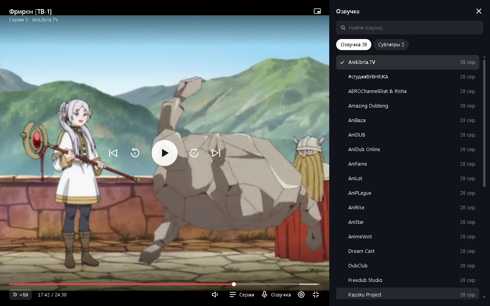
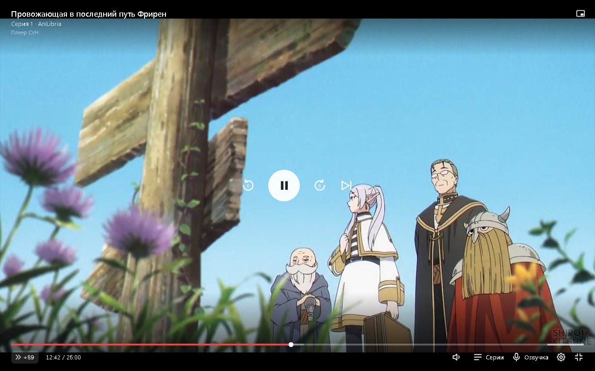
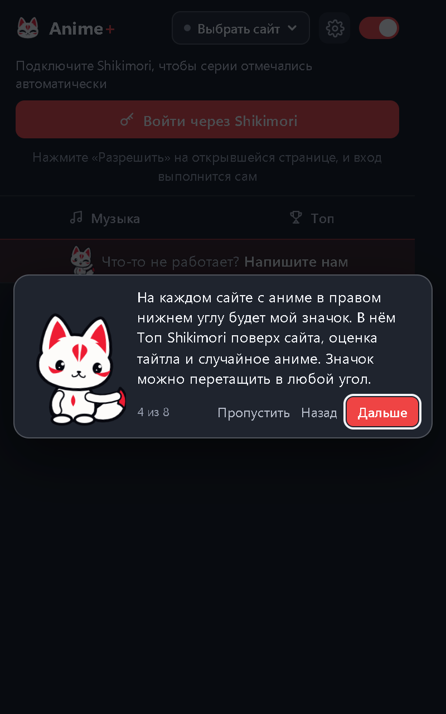
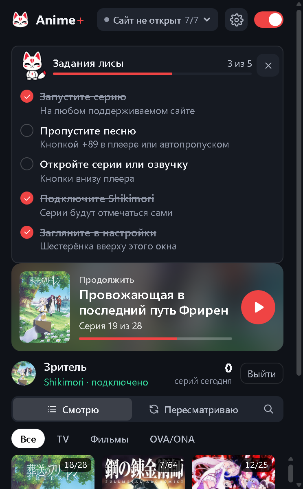
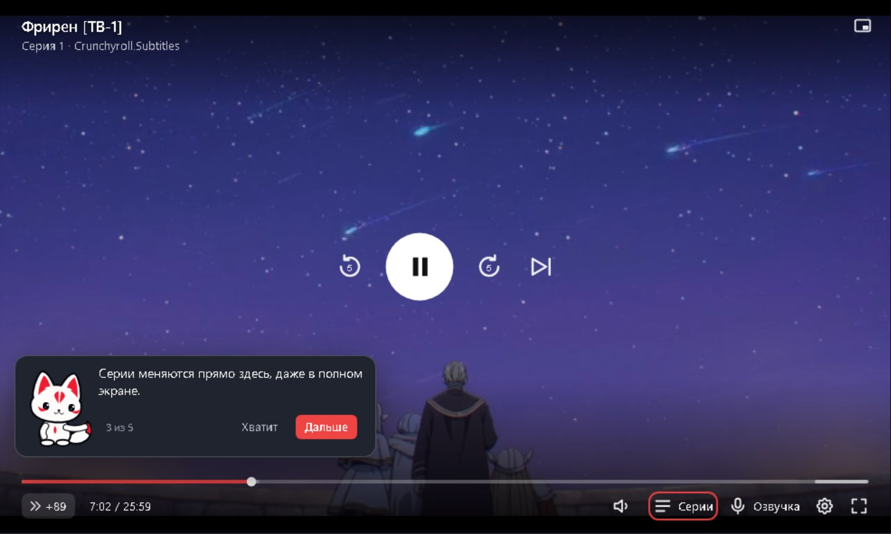

<p align="center">
  
</p>

<h1 align="center">Anime+</h1>

<p align="center">
  <b>Смотри аниме без лишних нажатий: все плееры в одной оболочке, смена плеера и озвучки без перерыва, пропуск опенингов и учёт в Shikimori.</b>
</p>

<p align="center">
  <a href="https://chromewebstore.google.com/detail/anime+/mgcaideibpbdddnbedoefmabladoaajg?hl=ru" target="_blank">
    
  </a>
  <a href="https://chromewebstore.google.com/detail/anime+/mgcaideibpbdddnbedoefmabladoaajg?hl=ru" target="_blank">
    
  </a>
  <a href="https://chromewebstore.google.com/detail/anime+/mgcaideibpbdddnbedoefmabladoaajg?hl=ru" target="_blank">
    
  </a>
</p>

<p align="center">
  
</p>

<p align="center">
  <a href="#-возможности">Возможности</a> •
  <a href="#-поддерживаемые-сайты">Сайты</a> •
  <a href="#-скриншоты">Скриншоты</a> •
  <a href="#-установка">Установка</a> •
  <a href="#️-управление">Управление</a> •
  <a href="#-приватность">Приватность</a> •
  <a href="#-поддержка">Поддержка</a>
</p>

---

## ⚡ Коротко

**Anime+** работает на AnimeGO, Jut-Su, YummyAnime, AnimeVost и других сайтах и убирает всё, что отвлекает от просмотра:

- 🎛️ **Все плееры в одной оболочке:** Kodik, Alloha, Aksor, CVH, Parlorate и AniBoom управляются одинаково.
- 🔀 **Плеер и озвучка меняются без перерыва:** видео продолжается с того же места и запускается само, полный экран остаётся.
- ⏭️ **Опенинги и эндинги пропускаются сами,** песня находится ещё до начала.
- 🍿 **Следующая серия включается сразу,** без ожидания и лишних нажатий.
- 🎬 **Серии и озвучка переключаются прямо в плеере,** даже в полном экране, а после перезагрузки серия продолжается с места остановки.
- 🎙️ **Ваша озвучка выбирается сама,** а ручной выбор запоминается для тайтла.
- 📊 **Просмотренные серии отмечаются в Shikimori** без вашего участия.

---

## ✨ Возможности

### 🎛️ Все плееры в одной оболочке
- Kodik, Alloha, Aksor, CVH, Parlorate и AniBoom: управление, панели и клавиши одни и те же. Какие плееры доступны, зависит от сайта и тайтла.
- Плеер выбирается кнопкой **«Плеер»** рядом с сериями и озвучкой и запоминается для сайта. По умолчанию это Kodik.
- Под названием серии всегда написано, какой плеер сейчас работает.
- Плеер со всеми сезонами открывает нужный сезон и серию, на которой вы остановились.

### 🔀 Смена плеера и озвучки без перерыва
- Плеер начал тормозить? Выберите другой: он продолжит с того же места и запустится сам, даже если видео стояло на паузе.
- Полный экран не сворачивается, а старый плеер сразу встаёт на паузу, поэтому два звука не наложатся.
- Громкость переходит в новый плеер.
- С озвучкой то же самое: выбрали другую, и серия идёт дальше с этого же места.
- Если браузер не разрешает новому плееру звук сразу, видео идёт без звука, а первое нажатие или клавиша в плеере его возвращают.

### 🎬 Удобное управление
- Управление появляется при движении мыши и не мешает смотреть.
- Серии, озвучка и плеер открываются своими кнопками в панелях поверх видео.
- Длинные сериалы листаются сотнями: переключатель «‹ 1001–1100 ›» стоит рядом с поиском по номеру, а нажатие на сотню открывает сетку всех сотен.
- На шкале отмечены опенинг и эндинг, при наведении видны кадры серии, если они есть у плеера.
- Настоящий полный экран, который не сбрасывается при смене серии.
- Кнопка **+89 секунд** для ручного пропуска и режим «картинка в картинке».
- После перезагрузки страницы серия продолжается с места остановки.

### ⏭️ Пропуск опенингов и эндингов
- **Анализ заранее:** расширение заранее проверяет звук следующих минут серии, поэтому песня находится ещё до начала и пропуск срабатывает сразу.
- Метки Kodik для вашей серии и озвучки работают и на других плеерах.
- Источники времени: метки плеера и сайта, общая база таймингов, узнавание песни по звуку, повтор между сериями тайтла и AniSkip.
- Песни узнаются для более чем 2500 тайтлов, база постоянно пополняется.
- Автопропуск опенинга и эндинга настраивается отдельно.
- Кнопка **«Вернуться»** исправляет ошибочный пропуск одним нажатием.
- Если вы сами вернулись к песне, плеер больше не перекинет вас вперёд.

### 🍿 Марафон серий
- Серия закончилась, и сразу запускается следующая.
- Если вы развернули плеер, полный экран сохраняется.

### 🎙️ Озвучка
- Автовыбор по вашему списку приоритетов.
- Озвучка, выбранная вручную, важнее автовыбора и запоминается для тайтла.

### 🦊 Лиса-экскурсовод
- При первом открытии лиса с логотипа показывает окно расширения и подсказывает, что есть в плеере.
- Лиса показывает смену плеера и озвучки прямо в плеере: открывает нужную панель и подсвечивает, куда нажать.
- Пять заданий отмечаются сами, когда вы их выполнили.
- Экскурсию можно пропустить или пройти заново в настройках.

### 📊 Shikimori
- Расширение определяет аниме и серию и само обновляет прогресс в профиле.
- Серия засчитывается после просмотра 80%, её можно досматривать частями. Перемотка в конец и реклама не считаются.
- Пересмотр старой серии не уменьшает прогресс.
- Для уже просмотренного тайтла статус меняется на **«Пересматриваю»**.
- Оценки Shikimori видны прямо на страницах тайтлов.

### 📱 Окно расширения
- Кнопка в шапке открывает все сайты плитками: нажатие на плитку открывает сайт, переключатель в углу выключает на нём Anime+. Пока список ни разу не открывали, кнопка **«Выбрать сайт»** подсвечена.
- Карточка **«Продолжить»** запускает последний тайтл одним нажатием.
- Ваши списки в виде обложек с прогрессом, поиском и фильтрами по типам.
- Опенинги и эндинги текущего аниме со ссылками на YouTube.
- Кнопка **«Что-то не работает? Напишите нам»** открывает форму поддержки.

### 🔎 Поиск нового аниме
- **Топ Shikimori:** весь рейтинг в одном окне, с подгрузкой при прокрутке и быстрым переходом по оценкам.
- **Случайное аниме** по вашим фильтрам: оценка и тип.
- **Кнопка `▶ Смотреть с Anime+`** на Shikimori ищет тайтл на включённых сайтах.
- **Кнопка `Смотреть на…`** открывает этот же тайтл на другом сайте.

### ✨ Дополнительно на AnimeGO
- Если тайтла нет на сайте, расширение покажет его карточку и предложит, где посмотреть.
- В строке поиска появляются и те тайтлы, которых нет на AnimeGO, со ссылкой на поиск на Jut-Su.
- Расширенное расписание дополняется тайтлами с Jut-Su и настраивается фильтрами.

### ⚙️ Настройки
- Всё для просмотра находится прямо в меню плеера и применяется сразу.
- Озвучки, случайное аниме и клавиши настраиваются на отдельной странице расширения.

---

## 🌍 Поддерживаемые сайты

| Сайт | Адрес |
| :--- | :--- |
| AnimeGO | [animego.me](https://animego.me), animego.org |
| Jut-Su | [jut-su.net](https://jut-su.net) |
| YummyAnime | [ru.yummyani.me](https://ru.yummyani.me), [old.yummyani.me](https://old.yummyani.me) |
| YummyAnime.TV | [yummyanime.tv](https://yummyanime.tv) |
| AnimeGO.online | [animego.online](https://animego.online) |
| YummyAnime.Club | [yammyanime.club](https://yammyanime.club) |
| AnimeVost | [animevost.org](https://animevost.org) и зеркала вида v14.vost.pw |

Каждый сайт можно отдельно включить или выключить в окне расширения.

AnimeVost часто меняет адрес. Все зеркала на vost.pw работают сразу, а если сайт переедет на совсем новый домен, окно расширения на нём предложит **«Включить Anime+ здесь»**: Chrome спросит разрешение только для этого адреса. На AnimeVost работают оболочка плеера, серии, качество 720p и 480p, пропуск песен и отметка в Shikimori. Блок «Смотреть на…» его пока не ищет.

<details>
<summary><b>Что работает на каких сайтах</b></summary>
<br>

| Функция | AnimeGO | Jut-Su | YummyAnime (ru, old) | YummyAnime.TV, AnimeGO.online, YummyAnime.Club |
| :--- | :---: | :---: | :---: | :---: |
| Улучшенный плеер и полный экран | ✅ | ✅ | ✅ | ✅ |
| Выбор плеера и смена без перерыва | ✅ | ✅ | ✅ | ✅ |
| Продолжение с места остановки | ✅ | ✅ | ✅ | ✅ |
| Пропуск опенингов и эндингов | ✅ | ✅ | ✅ | ✅ |
| Отметка серий в Shikimori | ✅ | ✅ | ✅ | ✅ |
| Автовыбор озвучки | ✅ | ✅ | — | ✅ |
| Топ Shikimori | ✅ | ✅ | ✅ | ✅ |
| Случайное аниме по вашим фильтрам | ✅ | ✅ | ✅ | ✅ |
| «Смотреть на…» другие сайты | ✅ | ✅ | ✅ | ✅ |
| Расширенное расписание | ✅ | — | — | — |
| Карточки тайтлов, которых нет на сайте | ✅ | — | — | — |
| Тайтлы вне каталога в строке поиска | ✅ | — | — | — |

На YummyAnime озвучку выбирает сам сайт, а сменить её можно в панели плеера.

</details>

---

## 📸 Скриншоты

<details>
<summary><b>🎬 Плеер</b></summary>
<br>

| Озвучка | Серии |
| :---: | :---: |
|  |  |

| Выбор плеера | Основной вид |
| :---: | :---: |
|  |  |

| Было: плеер Kodik | Стало: плеер CVH, та же сцена |
| :---: | :---: |
|  |  |

</details>

<details>
<summary><b>📱 Окно расширения и настройки</b></summary>
<br>

| Списки Shikimori | Сайты | Страница настроек |
| :---: | :---: | :---: |
|  |  |  |

</details>

<details>
<summary><b>🦊 Лиса-экскурсовод</b></summary>
<br>

| Экскурсия | Задания |
| :---: | :---: |
|  |  |

| Подсказка о смене плеера |
| :---: |
|  |

</details>

<details>
<summary><b>🏆 Топ Shikimori</b></summary>
<br>

| Весь рейтинг | Переход по оценкам |
| :---: | :---: |
|  |  |

</details>

<details>
<summary><b>🧭 Где посмотреть</b></summary>
<br>

| Кнопка на Shikimori | Тайтла нет на AnimeGO |
| :---: | :---: |
|  |  |

</details>

<details>
<summary><b>🗓️ Расписание на AnimeGO</b></summary>
<br>

| Расписание | Его настройки |
| :---: | :---: |
|  |  |

</details>

---

## 🚀 Установка

**Из Chrome Web Store (рекомендуется):** откройте [страницу расширения](https://chromewebstore.google.com/detail/anime+/mgcaideibpbdddnbedoefmabladoaajg?hl=ru) и нажмите **«Установить»**.

<details>
<summary><b>Из исходного кода</b></summary>
<br>

1. Нажмите **`Code` ➔ `Download ZIP`** вверху страницы и распакуйте архив.
2. Откройте в браузере `chrome://extensions/`.
3. Включите **«Режим разработчика»** в правом верхнем углу.
4. Нажмите **«Загрузить распакованное расширение»** и укажите папку с проектом.

</details>

---

## ⌨️ Управление

| Клавиша | Действие |
| :---: | :--- |
| <kbd>F</kbd> | На весь экран и обратно |
| <kbd>Esc</kbd> | Закрыть панель или выйти из полного экрана |
| <kbd>Пробел</kbd> | Пауза и продолжение |
| <kbd>S</kbd> | Пропустить опенинг или эндинг, вне песни перемотать на 89 секунд |
| <kbd>←</kbd> / <kbd>→</kbd> | Перемотка на 5 секунд назад и вперёд |
| <kbd>N</kbd> / <kbd>P</kbd> | Следующая и предыдущая серия |

Колесо мыши над регулятором громкости меняет громкость на 1%.

Клавиши <kbd>F</kbd>, <kbd>S</kbd>, <kbd>←</kbd>, <kbd>→</kbd>, <kbd>N</kbd> и <kbd>P</kbd> можно заменить на странице настроек расширения.

---

## 🔒 Приватность

- Настройки и данные хранятся локально в вашем браузере.
- Расширение не собирает данные для рекламы и аналитики.
- Звук серии анализируется только на вашем устройстве, не сохраняется и никуда не отправляется. Для анализа заранее расширение скачивает звук следующих минут серии с серверов того же плеера: обычно 2–20 МБ на серию и не больше 45 МБ. В режиме экономии трафика это не делается.
- Если время опенинга или эндинга найдено по звуку, на сервер разработчика отправляются только ID тайтла, номер серии, название озвучки, длина видео и найденное время. Так другие зрители получают пропуск сразу. IP-адрес не хранится. Функция отключается в меню плеера: «Пропуск по звуку».
- Если вы подключаете Shikimori, запросы идут от вашего имени, а код авторизации и токены проходят через прокси-сервер разработчика.
- Для поиска тайтла поддерживаемым сайтам передаётся его название.
- Текст из строки поиска на AnimeGO отправляется в Shikimori, чтобы показать тайтлы, которых нет на сайте.
- Сообщение из формы поддержки уходит разработчику, только если вы сами его отправили.

Подробнее: [политика конфиденциальности](PRIVACY_POLICY.md).

---

## 💬 Поддержка

Нашли ошибку или есть идея? Напишите прямо из расширения: нажмите **«Что-то не работает? Напишите нам»** в его окне. Если что-то сломалось, укажите сайт, тайтл и номер серии.

---

## 🛠️ Разработка

Сборка не нужна: папку проекта можно сразу загрузить как распакованное расширение. Для проверок нужен [Node.js](https://nodejs.org):

```bash
npm install
npm run check
```

`npm run check` запускает линтер и тесты. Устройство проекта описано в [AI_OVERVIEW.md](AI_OVERVIEW.md).

---

<p align="center">
  <a href="https://github.com/lredi1337"></a><br>
  Создано разработчиком <a href="https://github.com/lredi1337">l_red_i</a> для аниме-сообщества. Лицензия <a href="LICENSE">MIT</a>.
</p>
